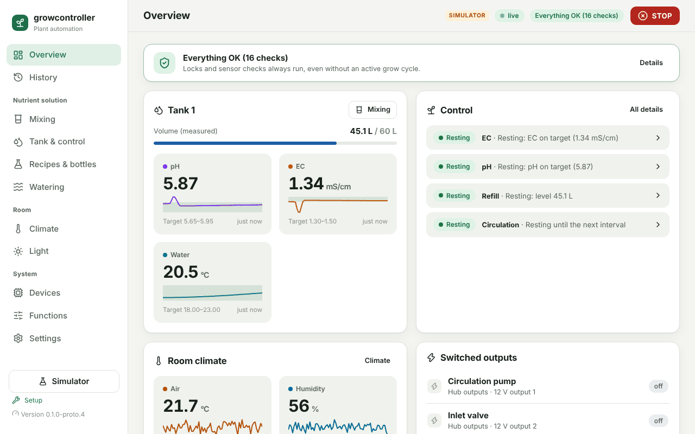
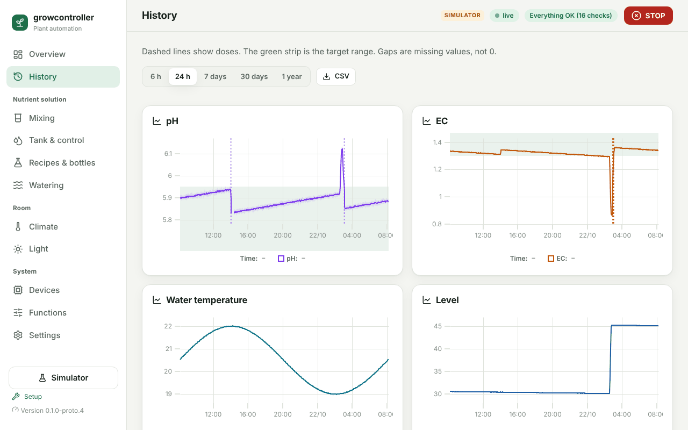
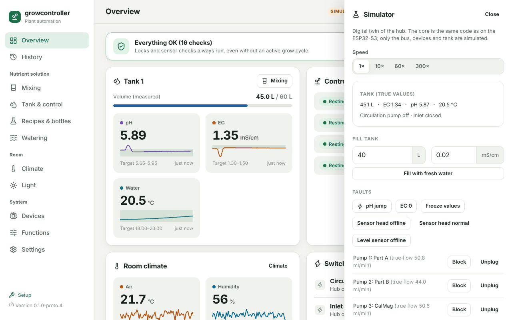

# Try the demo

The demo is the complete growcontroller software running on your
computer with a simulated device, pumps, sensors and tank (a "digital
twin"). Nothing is installed, and it needs no hardware, no account and
no internet. It is the best way to see what the project does today and
to tell us what you think. You need a computer: Windows, macOS or Linux.

> **The demo controls nothing real.** It cannot switch a pump or a
> socket in your home. The prototype is not meant for real hardware yet:
> see the safety note in the [README](../README.md).

This guide describes the newest code. Until release 0.1.0-proto.5 is
out, the download (0.1.0-proto.4) is older and differs in places: it
opens in German (switch under **Einstellungen › Darstellung und Info ›
Sprache**, that is Settings › Display and info › Language), its menu is
not grouped yet, and a mix cancelled halfway does not yet say what is
missing.



## 1. Download

Open the [Releases page](https://github.com/Wokesay/growcontroller-software/releases)
and take the top release. While the project is a prototype, every
release is marked "Pre-release"; that is expected. Open **Assets** (click
it if it is collapsed); you need only the zip for your system:

- **Windows (64-bit):** the file ending in `-windows-x64.zip`.
- **macOS 14 or later** (Apple silicon and Intel): the file ending in
  `-macos-universal.zip`.
- **Linux (x86-64)**, for example Ubuntu 22.04, Debian 12 or newer: the
  file ending in `-linux-x64.zip`. An older distribution may lack the C
  library it needs.
- **Raspberry Pi or another ARM Linux:** no download yet.
  [Build it yourself](#8-build-it-yourself-instead), or try the
  [Home Assistant app](HOME_ASSISTANT.md).

Download only from the Releases page. CI runs store packages too, but
those of pull requests are built from code nobody has reviewed yet.

**Optional: check the download.** The release's `SHA256SUMS` lists a
checksum for every file. Compute the checksum of the zip (before you
unpack it) and compare; upper or lower case does not matter:

- Windows (PowerShell): `Get-FileHash .\growcontroller-simulator-*-windows-x64.zip`
- macOS: `shasum -a 256 growcontroller-simulator-*-macos-universal.zip`
- Linux: `sha256sum -c SHA256SUMS --ignore-missing` (with `SHA256SUMS`
  in the same folder)

A match means the file is complete and is the one published with the
release. That the release workflow built it from the release's tag is
shown by its build provenance attestation; checking it needs GitHub's
`gh` tool ([`RELEASE.md`](RELEASE.md), "Anyone can check a download").

## 2. Start

The program is not signed by Microsoft or Apple, so both warn the first
time. Override the warning only for the zip you downloaded yourself from
this repository's Releases page.

**Windows**

1. Right-click the zip › **Extract All…** › **Extract**. Do not start the
   program from inside the zip: it could not keep its data.
2. In the unpacked folder, double-click `growcontroller-simulator`
   (Windows may hide the ending `.exe`).
3. If Windows says "Windows protected your PC": **More info**, then
   **Run anyway**.

**macOS**

1. Double-click the zip to unpack it (Safari may have done this
   already).
2. Open **Terminal** (Cmd+Space, type `Terminal`, Enter).
3. Type `cd` and a space, drag the unpacked folder into the Terminal
   window, and press Enter.
4. Type `xattr -d com.apple.quarantine growcontroller-simulator` and
   press Enter. This allows only this one program.
5. Type `./growcontroller-simulator` and press Enter (or double-click it
   from now on).

**Linux**

1. Unpack the zip.
2. In a terminal in the unpacked folder: `./growcontroller-simulator`.

A console window opens. At the first start the demo first calculates
48 hours of history, which takes a few seconds, then your browser opens
`http://127.0.0.1:8080` (8081 and up if that port is taken). Keep the
console window open: closing it ends the demo. Start it only once at a
time: a second copy would use the same data folder.

Sign in with the password **`demo-passwort`** (German for "demo
password"). The demo starts in English; German is under **Settings ›
Display and info › Language**. A demo folder saved by an older version
keeps its German: delete the folder `growcontroller-daten` next to the
program for the English demo.

The demo password exists only in the simulator; a real device never has
a default password. The demo listens only on `127.0.0.1`, so other
devices in your network cannot reach it.

Stuck? See [If it does not start](#3-if-it-does-not-start).

## 3. If it does not start

| What you see | What to do |
|---|---|
| The browser does not open | Open `http://127.0.0.1:8080` yourself. The console window names the address. |
| "Windows protected your PC" | **More info → Run anyway**, for the zip from this repository's Releases page only. |
| macOS says the program is damaged or cannot be checked | First check the zip against `SHA256SUMS` ([step 1](#1-download)). A different value means a broken download: download it again. If it matches, run the `xattr` command from step 2. |
| Linux: "Permission denied" | `chmod +x growcontroller-simulator`, then start it again. |
| Linux: "GLIBC_2.34 not found" or similar | Your distribution is older than the build; [build it yourself](#8-build-it-yourself-instead). |
| Windows: Smart App Control blocked it, with no **Run anyway** | Smart App Control blocks every program that is not signed, so the demo cannot start there yet. Use WSL instead ([section 8](#8-build-it-yourself-instead)). |
| Your antivirus blocks it | Do not switch your antivirus off. Check the zip against `SHA256SUMS` ([step 1](#1-download)). If it matches, tell us in an issue which scanner flagged it and what it called it. If it does not match, do not run it, and report it privately ([`SECURITY.md`](../SECURITY.md)). |
| `demo-passwort` does not work, or the demo asks you to set a password | You loaded another scenario or changed the password earlier. Close the console window, delete the folder `growcontroller-daten` next to the program, and start again. |
| A blank page or an error in the page | Please report it ([section 6](#6-tell-us-what-you-think)) with your system and browser. |

## 4. What you see

The demo starts as a hub (the growcontroller device) that has been
running for two days: a 60 L tank with a pH/EC probe, a level sensor,
four dosing pumps (part A, part B, CalMag, pH−), a circulation pump, an
inlet valve and a Wi-Fi power strip with light and fans. The last 48
hours of history are already there.

- **The headline**, for example "Everything OK (16 checks)", is the
  monitoring (also called the watchdog). It only checks and never
  switches anything; when something is wrong it says what, in words.
- **Tank:** pH, EC and water temperature with their targets.
- **Control:** one row per function (EC, pH, refill, circulation) with its
  state. Click a row, or open **Tank & control**, for its checklist: why
  it doses right now, or why not.
- **STOP** (top right) switches every pump and output off at once.
- **Simulator** (bottom left; in a narrow window, the round button at the
  bottom right) opens the simulator panel: speed, fresh water, faults and
  scenarios. A real hub has no such panel.



## 5. A short tour

About fifteen minutes, at normal speed unless a step says otherwise.
Each step names what to look for.

1. **Why is it (not) dosing?** Open **Tank & control** and look at the pH
   row's checklist, for example "EC 1.34 above 0.50: pH can be measured",
   "Rest time after the EC dose is over", "EC top-up done", "pH− bottle
   ready".
2. **History.** Open **History**: 24 hours of pH, EC, temperature and
   level, doses as dashed lines, the green strip is the target. Gaps are
   missing values, never 0. **CSV** exports the data.
3. **Break the pH probe.** **Simulator › Faults › pH jump**: the probe
   now reads 2.1 too high. Within seconds the headline turns red, the pH
   tile shows **Jump lock** with the reason, and pH correction is
   blocked: the hub does not dose on a value that jumped without a cause.
   Look at it, then end the fault right away with **Faults › Sensor head
   normal**. The drop back is a jump too, so pH stays locked; the lock
   lifts by itself after 15 minutes of steady readings. A probe that
   stays wrong by the same amount for those 15 minutes is trusted again:
   that is a known limit of a single probe, recorded in SD-085.
4. **Speed up time.** **Simulator › Speed › 60×**: a minute passes in a
   second, and the pH lock from step 3 lifts within about 15 seconds.
   Set the speed back to **1×** before the next step.
5. **Mix a tank.** In **Tank & control**, click **Start maintenance
   mode**: it tells the hub that someone works at the tank, so changed
   readings are expected. In the simulator panel, under **Fill tank**,
   leave 40 L and click **Fill with fresh water**. Then open **Mixing**,
   pick a recipe, choose **New batch** and enter `40` L. The plan lists
   each bottle with its millilitres and pumping time; **Start mixing**
   runs them one after the other.
6. **Cancel halfway.** While the mix runs, click **Cancel**: the card
   says what is in the tank, what is missing, and that the ratio of the
   pair is wrong until the rest goes in. Afterwards, end maintenance mode
   in **Tank & control** with **End now**.
7. **Power cut.** **Simulator › Power cut / restart**, then sign in
   again. The hub restarts with pumps, valves and the light off; the fans
   come back on (unless STOP was active), control starts afresh (so
   circulation runs again), locks are kept, and a mix or manual dose that
   was interrupted is reported, not resumed.
8. **Start from scratch.** **Simulator › Scenario › Empty (stage 0)**
   erases the demo and starts the first-time setup: set a password of
   your own (the **Simulator** button comes back after that), detect
   devices, set up bottles and recipes. **Demo (ready to use)** brings the
   demo and `demo-passwort` back; that takes a few seconds.
9. **Report a problem.** **Settings › Report a problem**: describe what
   happened in a sentence and click **Create diagnostic package**. The hub
   builds it (version, settings, states, the events of the last 72 hours;
   no passwords, sessions or Wi-Fi details), shows a report number and,
   under **View contents**, what is inside. **Report publicly on GitHub**
   opens a new issue with the report number; if GitHub shows a list of
   forms instead, choose **Bug report** and enter the report number
   there.



## 6. Tell us what you think

Feedback on the demo is the most useful contribution right now. We would
like to know:

- Did it start? On which system, and where did you get stuck?
- Do the texts explain why something happens or does not happen?
- What would you need before you would trust it with your own tank:
  which system (for example DWC, RDWC, drip, ebb and flow), which pumps
  and probes, which language and units?
- What is missing, and what is too much?

Where:

- **Feedback, ideas and questions:** [Discussions](https://github.com/Wokesay/growcontroller-software/discussions).
- **Something does not work:** a [bug report](https://github.com/Wokesay/growcontroller-software/issues/new?template=bug.yml);
  choose "simulator only" as the hardware. A screenshot helps; crop the
  browser's address bar.
- **A device you use or would like to use:** the
  [device form](https://github.com/Wokesay/growcontroller-software/issues/new?template=device.yml).
- **A security problem:** never in public, see [`SECURITY.md`](../SECURITY.md).

Issues and discussions are public and show your GitHub account: please
leave out passwords, Wi-Fi details and where you live.

## 7. Start over and options

- **Start over:** close the console window, then delete the folder
  `growcontroller-daten` next to the program.
- **If that folder cannot be created or read**, the demo runs in memory
  only, says so in the console window, and forgets everything when it
  ends.
- **Options:** start the program from a terminal in its folder, for
  example `.\growcontroller-simulator.exe --scenario neu --open` on
  Windows or `./growcontroller-simulator --scenario neu --open` on macOS
  and Linux. `--help` lists every option.

  | Option | Effect |
  |---|---|
  | `--scenario neu` | an empty hub with the first-time setup, in English |
  | `--scenario stufe1` | an empty hub with the dosing pumps, a pH/EC probe and 40 L in the tank, not set up |
  | `--speed 60` | time-lapse from the start |
  | `--port 9000` | another port |
  | `--prefill 0` | no history calculated in advance |
  | `--data DIR` | keep the data in this folder |
  | `--open` | open the browser |

  Started with any option, the demo keeps nothing after it ends and does
  not open the browser, unless you add `--data` and `--open`: for
  example `--data growcontroller-daten --open` keeps the usual folder.
  `--scenario` applies only to an empty data folder: with a folder that
  already holds a demo, the demo there carries on.

## 8. Build it yourself instead

You need Git, CMake 3.20 or later, Ninja, a C++17 compiler and Node.js
22.12 or later (`.nvmrc` names the version CI uses). The first build
downloads three pinned single-header libraries (see `cmake/deps.cmake`
for an offline build) and the web app's npm packages.

```bash
git clone https://github.com/Wokesay/growcontroller-software.git
cd growcontroller-software
tools/dev.sh
# → http://127.0.0.1:8080, password: demo-passwort
```

- **Debian 12, Ubuntu 22.04 or newer:** `sudo apt install git cmake
  ninja-build g++`, plus Node.js 22 from [nodejs.org](https://nodejs.org/)
  or your version manager. Debian 11 ships a CMake that is too old.
- **macOS:** the Xcode command line tools (`xcode-select --install`), then
  `brew install cmake ninja node`. CI builds the macOS package on
  macOS 14 and every target with clang.
- **Windows:** the simplest way is WSL 2 with Ubuntu and the steps above;
  the browser on Windows reaches `http://127.0.0.1:8080`. A native build
  with Visual Studio 2022 is what CI does for the Windows package
  (`.github/workflows/packages.yml`).
- **Raspberry Pi** (a 64-bit system on Debian 12 or newer): the Debian
  steps should work; nobody has tried it yet, so please tell us.

**Opening it from another device** (for example a Raspberry Pi without a
screen): start it on the device's own address, for example
`tools/dev.sh --host 192.168.1.20` (use yours), and open
`http://192.168.1.20:8080`. Do this only in a home network you trust,
never on a machine that can be reached from the internet: anyone in
that network can sign in with the demo password, and the demo sends it
unencrypted. For a password of your own, remove the folder `sim-data`
and start with `PASSWORD='…' tools/dev.sh --host …`, with a password you
use nowhere else. Never add `--allow-reset`; it is for automated tests
only.

`SCENARIO=neu tools/dev.sh` starts the empty hub. More for developers:
[`CONTRIBUTING.md`](../CONTRIBUTING.md) and [`TESTING.md`](TESTING.md).
